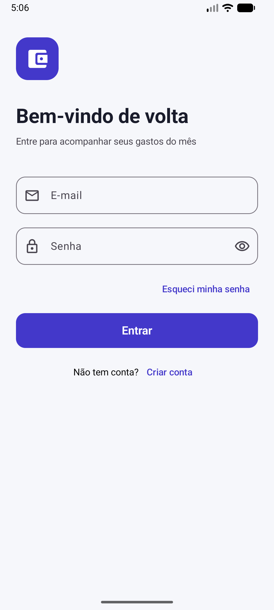
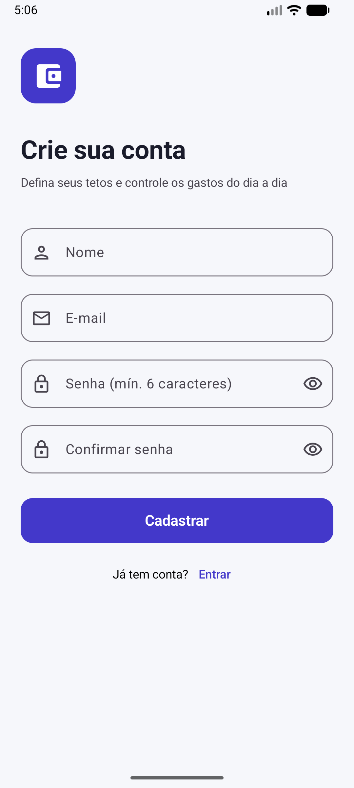
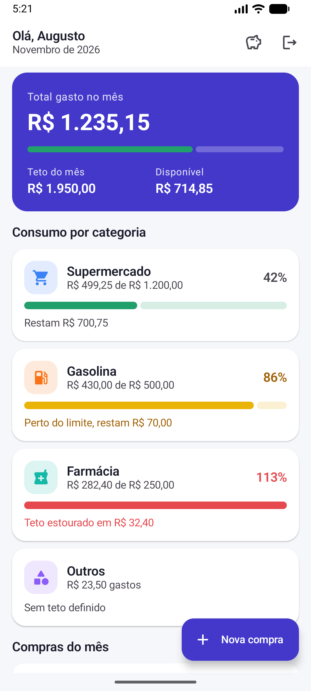
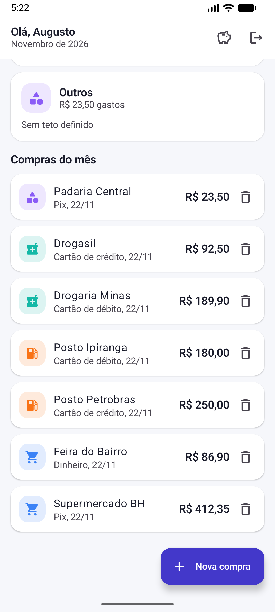
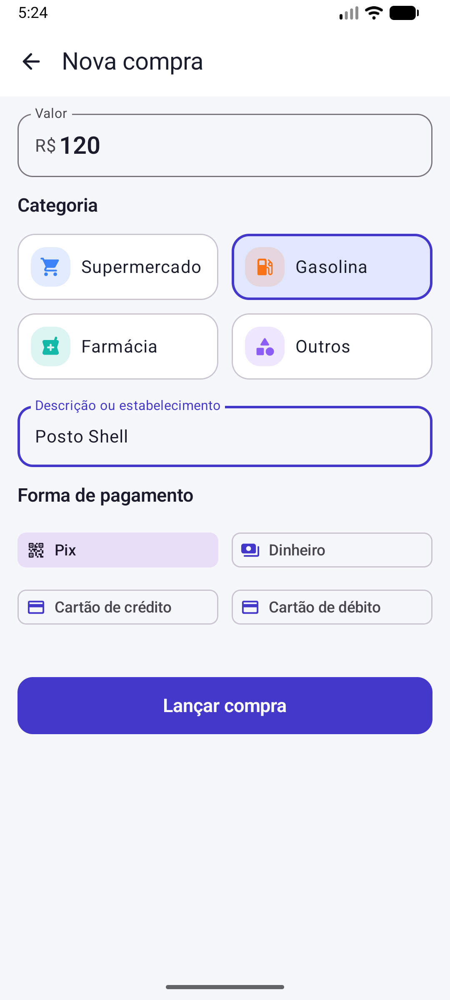
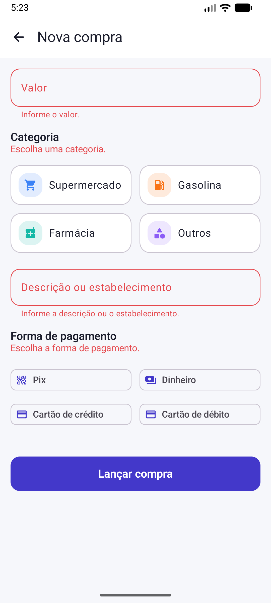
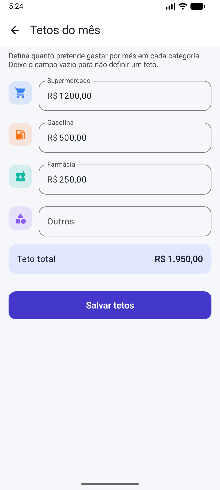
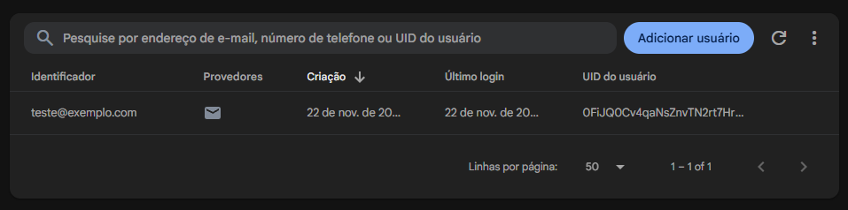

# Expense Tracker

Aplicativo Android de controle de gastos operacionais do dia a dia, desenvolvido em Kotlin com Jetpack Compose. O foco são os itens essenciais: Supermercado, Gasolina e Farmácia, além de uma categoria Outros. O projeto segue a arquitetura MVVM, usa o Firebase Authentication para login com e-mail e senha e salva as compras e os tetos localmente com Room.

Aluno: Augusto Alex Caixeta Silva

## Protótipo no Figma

Link público: https://www.figma.com/design/EXD2NsRmDuJpKFlX0UAdtg/ExpenseTracker?node-id=0-1

O protótipo é navegável: no modo Present, os botões levam às telas correspondentes.

O protótipo contém os seguintes fluxos:

- Login e registro
- Painel do mês com o resumo global e o consumo de cada categoria
- Lançamento rápido de compra
- Definição dos tetos por categoria

## Telas e funcionalidades

### Login

- Entrada com e-mail e senha pelo Firebase Authentication
- Validação do formato do e-mail e da senha antes de chamar o Firebase
- Botão para mostrar ou ocultar a senha
- Recuperação de senha: envia o link de redefinição para o e-mail digitado
- Mensagens de erro específicas para credenciais incorretas, conta desativada, excesso de tentativas e falta de conexão
- Sessão persistente: com um usuário já autenticado, o app abre direto no painel



### Registro

- Criação de conta com nome, e-mail, senha e confirmação de senha
- Validação de nome obrigatório, e-mail válido, senha com pelo menos 6 caracteres e senhas iguais
- O nome é salvo no perfil do Firebase e usado na saudação do painel
- Depois do cadastro, o usuário já entra autenticado no painel



### Painel do mês

Tela inicial, atualizada em tempo real a cada compra lançada ou excluída.

- Resumo global com o total gasto no mês corrente, o teto do mês (soma dos tetos das categorias) e o saldo disponível, ou o valor que passou do teto
- Um cartão por categoria com o valor gasto, o teto, o percentual consumido e uma barra de progresso com alerta de cores:
  - verde: abaixo de 80% do teto
  - amarelo: a partir de 80% do teto
  - vermelho: teto estourado
- Tocar no cartão de uma categoria abre o lançamento com a categoria já escolhida
- Atalhos para os tetos do mês e para sair da conta, com confirmação



Mais abaixo fica a lista das compras do mês, da mais recente para a mais antiga, com a categoria, a forma de pagamento, o dia e o valor. Cada compra pode ser excluída, com confirmação.



### Nova compra

- Lançamento rápido com valor, categoria obrigatória (Supermercado, Gasolina, Farmácia ou Outros), descrição ou estabelecimento e forma de pagamento (Pix, Dinheiro, Cartão de crédito ou Cartão de débito)
- O campo de valor aceita apenas dígitos, vírgula e ponto. Letras e o sinal de menos são descartados durante a digitação
- Ao salvar, valor vazio, não numérico, negativo, zero ou acima de R$ 1.000.000,00 é rejeitado



Todos os campos são validados de uma vez, e cada campo com problema mostra a sua mensagem:



### Tetos do mês

- Teto mensal individual para cada categoria (ex.: R$ 1.200 para Supermercado, R$ 500 para Gasolina, R$ 250 para Farmácia)
- Campo vazio significa categoria sem teto
- O teto total é somado enquanto o usuário digita
- Os valores passam pela mesma validação do lançamento de compras



### Geral

- Compras e tetos separados por usuário
- Tema claro e escuro, conforme o sistema

## Requisitos

| Item | Versão |
|---|---|
| Android Studio | Versão recente com suporte a AGP 9.5 |
| JDK | 17 ou superior (o JDK embutido no Android Studio funciona) |
| Android mínimo | 8.0 (API 26) |
| compileSdk / targetSdk | 37 |
| Kotlin | 2.2.10 (embutido no AGP 9) |
| Android Gradle Plugin | 9.5.2 |
| Room | 2.8.5 (com KSP 2.3.14) |

## Build e execução

### 1. Clonar o repositório

```bash
git clone https://github.com/augustocaixeta/expense-tracker-android.git
cd expense-tracker-android
```

### 2. Configuração do Firebase

O arquivo `app/google-services.json` do projeto Firebase usado no desenvolvimento já está no repositório, então o build funciona sem configuração adicional.

Para usar um projeto Firebase próprio:

1. Crie um projeto no [Console do Firebase](https://console.firebase.google.com/).
2. Adicione um app Android com o nome de pacote `br.edu.iftm.expensetracker`.
3. Baixe o `google-services.json` e substitua o arquivo em `app/`.
4. Em Authentication, na aba Método de login, ative o provedor E-mail/senha.

### 3. Executar

Pelo Android Studio:

1. Abra a pasta do projeto e aguarde a sincronização do Gradle.
2. Selecione um emulador ou aparelho com Android 8.0 ou superior.
3. Clique em Run.

Pela linha de comando, com um emulador aberto ou aparelho conectado:

```bash
./gradlew installDebug
```

No Windows, use `gradlew.bat installDebug`.

### 4. Testes unitários

```bash
./gradlew test
```

Os testes em `app/src/test` cobrem a validação dos valores (`MoneyTest`) e o cálculo das faixas de alerta e dos totais do mês (`BudgetSummaryTest`).

## Arquitetura MVVM

### Estrutura de pastas

```
app/src/main/java/br/edu/iftm/expensetracker/
├── ExpenseTrackerApp.kt            Application que cria o banco e os repositórios
├── MainActivity.kt                 Ponto de entrada, aplica o tema e a navegação
├── data/                           Model
│   ├── Category.kt                 Enums Category e PaymentMethod
│   ├── Expense.kt                  Entidade Room da compra
│   ├── Budget.kt                   Entidade Room do teto de uma categoria
│   ├── BudgetSummary.kt            Resumo do mês e regra das faixas de alerta
│   ├── Money.kt                    Validação e conversão de valores em centavos
│   ├── Converters.kt               Conversão de LocalDate para o Room
│   ├── ExpenseDao.kt               Consultas das compras
│   ├── BudgetDao.kt                Consultas dos tetos
│   ├── AppDatabase.kt              Banco Room
│   ├── ExpenseRepository.kt        Acesso às compras e aos tetos
│   └── AuthRepository.kt           Acesso ao Firebase Authentication
└── ui/                             View e ViewModel
    ├── auth/
    │   ├── AuthViewModel.kt        StateFlow<AuthUiState>
    │   └── AuthScreens.kt          LoginScreen e RegisterScreen
    ├── dashboard/
    │   ├── DashboardViewModel.kt   StateFlow<DashboardUiState>
    │   └── DashboardScreen.kt      Resumo global, categorias e compras do mês
    ├── expense/
    │   ├── ExpenseFormViewModel.kt StateFlow<ExpenseFormUiState>
    │   └── ExpenseFormScreen.kt    Lançamento rápido de compra
    ├── budget/
    │   ├── BudgetViewModel.kt      StateFlow<BudgetUiState>
    │   └── BudgetScreen.kt         Tetos por categoria
    ├── components/
    │   ├── Components.kt           Ícone da categoria
    │   ├── Visuals.kt              Nomes, ícones e cores de categorias, pagamentos e faixas
    │   └── Format.kt               Formatação de moeda e datas
    ├── navigation/
    │   ├── Routes.kt               Rotas tipadas com @Serializable
    │   └── AppNavHost.kt           Grafo de navegação
    └── theme/
        └── Theme.kt                Cores, tipografia e Material 3
```

Os textos da interface ficam em `res/values/strings.xml`, e o código usa apenas `stringResource`.

### Responsabilidades

| Camada | Responsabilidade | Arquivos |
|---|---|---|
| Model | Representa os dados e as regras de negócio (validação de valores, cálculo do consumo e das faixas de alerta). Os repositórios são o único ponto de acesso ao Firebase e ao Room. | `data/` |
| ViewModel | Mantém o estado da tela em um `StateFlow`, valida as entradas e chama os repositórios dentro do `viewModelScope`. Sobrevive a mudanças de configuração, como a rotação da tela, e não depende de Compose. | `*ViewModel.kt` |
| View | Funções `@Composable` que exibem o estado recebido com `collectAsStateWithLifecycle()` e repassam os eventos do usuário (cliques e digitação) ao ViewModel. Não contêm regra de negócio. | `*Screen.kt` |

O Model não conhece nenhuma classe de interface. A categoria, por exemplo, é o enum `Category`, e a conversão para nome, ícone e cor acontece na camada de UI, em `Visuals.kt`. Da mesma forma, os erros de validação chegam à tela como o enum `AmountError`, e a tela escolhe o texto correspondente no `strings.xml`.

O banco e os repositórios são criados uma única vez na classe `ExpenseTrackerApp`. Cada ViewModel tem uma `Factory` que busca os repositórios nessa classe, sem biblioteca de injeção de dependência.

### Fluxo de estado

O fluxo de dados é unidirecional:

```
  View  ──── evento ────▶  ViewModel  ──── chamada suspend ────▶  Repository  ────▶  Room
   ▲                          │                                       │
   └──── novo estado ─────────┘◀────────── Flow com os dados ─────────┘
```

Exemplo ao lançar uma compra:

1. O usuário preenche o formulário na `ExpenseFormScreen` e toca em Lançar compra.
2. A tela chama `viewModel.save()`.
3. O `ExpenseFormViewModel` valida todos os campos. Se algum estiver inválido, atualiza o estado com os erros e a tela marca os campos em vermelho.
4. Com tudo válido, o ViewModel chama `expenses.add(...)`, que grava a compra no Room, e marca `finished = true` para a tela voltar ao painel.
5. O Room emite a nova lista de compras pelo `Flow` da consulta do mês. O `DashboardViewModel` combina essa lista com os tetos (`combine`), recalcula o resumo com `summarize()` e publica um novo `DashboardUiState` com `stateIn`.
6. O painel observa o `StateFlow` e é recomposto com a barra de progresso, a cor de alerta e o saldo atualizados.

### Persistência com Room

| Tabela | Chave | Campos |
|---|---|---|
| `expenses` | `id` (autoincremento) | `userId`, `amountCents`, `category`, `description`, `paymentMethod`, `spentOn`, `createdAt` |
| `budgets` | `userId` + `category` | `limitCents` |

- Os valores são gravados em centavos (`Long`) para evitar erros de arredondamento de ponto flutuante.
- A data da compra é gravada como número de dias desde 01/01/1970 (`Converters.kt`), o que permite filtrar o mês corrente com `BETWEEN` entre o primeiro e o último dia.
- Os enums `Category` e `PaymentMethod` são gravados pelo nome.
- Todas as consultas filtram pelo `uid` do usuário autenticado, então duas contas no mesmo aparelho não compartilham dados.
- As consultas retornam `Flow`, e o Room emite um novo valor a cada alteração na tabela. É isso que mantém o painel atualizado em tempo real.

### Validação dos valores

A validação fica no Model, em `Money.kt`, e é coberta por testes unitários:

1. `sanitizeAmountInput()` é aplicado a cada tecla: letras, espaços e o sinal de menos são descartados antes de chegar ao campo, inclusive em textos colados.
2. `parseAmount()` é chamado ao salvar e aceita apenas o formato `^\d{1,9}([.,]\d{1,2})?$`, com vírgula ou ponto e no máximo duas casas decimais. O resultado é um `AmountResult.Valid` com os centavos ou um `AmountResult.Invalid` com o motivo:

| Entrada | Resultado |
|---|---|
| `49,90` ou `49.90` | 4990 centavos |
| vazio | `REQUIRED` |
| `-10` | `NEGATIVE` |
| `abc`, `10,999`, `1,2,3` | `INVALID` |
| `0` ou `0,00` | `NOT_POSITIVE` (nos tetos, zero é aceito e significa sem teto) |
| acima de `1000000` | `TOO_LARGE` |

Por segurança, o `ExpenseRepository` também recusa valores menores ou iguais a zero.

### Faixas de alerta

A regra fica em `levelOf()`, em `BudgetSummary.kt`:

| Consumo do teto | Faixa | Cor |
|---|---|---|
| sem teto definido | `NO_LIMIT` | sem barra |
| abaixo de 80% | `SAFE` | verde |
| de 80% até 100% | `WARNING` | amarelo |
| acima de 100% | `EXCEEDED` | vermelho |

O saldo disponível do resumo global é a soma dos tetos menos o total gasto no mês, incluindo as compras em Outros.

## Integração com o Firebase Authentication

### Dependências

- Plugin `com.google.gms.google-services`, que lê o `google-services.json`
- `firebase-bom` e `firebase-auth`
- `kotlinx-coroutines-play-services`, que permite usar `.await()` nas `Task` do Firebase

### AuthRepository

Toda a comunicação com o Firebase fica na classe `AuthRepository`, que usa `FirebaseAuth.getInstance()`. Os ViewModels dependem dessa classe e não acessam o Firebase diretamente.

| Ação | Método do Firebase |
|---|---|
| Registro | `createUserWithEmailAndPassword()` seguido de `updateProfile()` para salvar o nome |
| Login | `signInWithEmailAndPassword()` |
| Recuperação de senha | `sendPasswordResetEmail()` |
| Logout | `signOut()` |
| Verificação de sessão | `currentUser` |

As funções do repositório são `suspend` e retornam `Result<T>`. Quando uma chamada falha, o repositório lança uma `AuthException` com o enum `AuthError`, identificado pelo tipo da exceção ou pelo código de erro do Firebase. O `AuthViewModel` converte esse motivo em um `AuthFormError`, e a tela exibe a mensagem correspondente do `strings.xml`.

### Redirecionamento após o login

Quando o login ou o registro termina com sucesso, o `AuthViewModel` altera o campo `isLoggedIn` do estado para `true`. O `AppNavHost` observa esse valor e navega para a rota `Dashboard`, removendo as telas de autenticação da pilha. Com isso, o botão voltar não retorna ao login.

Ao abrir o app, se `currentUser` não for nulo, o painel é definido como tela inicial.

### Usuários no console do Firebase

Contas criadas pela tela de registro do app aparecem no console do Firebase, em Authentication, com o provedor E-mail/senha.



## Tecnologias

- Kotlin 2.2
- Jetpack Compose com Material 3
- ViewModel e StateFlow
- Navigation Compose
- Room com KSP
- Firebase Authentication
- Kotlin Coroutines e Flow
- JUnit
